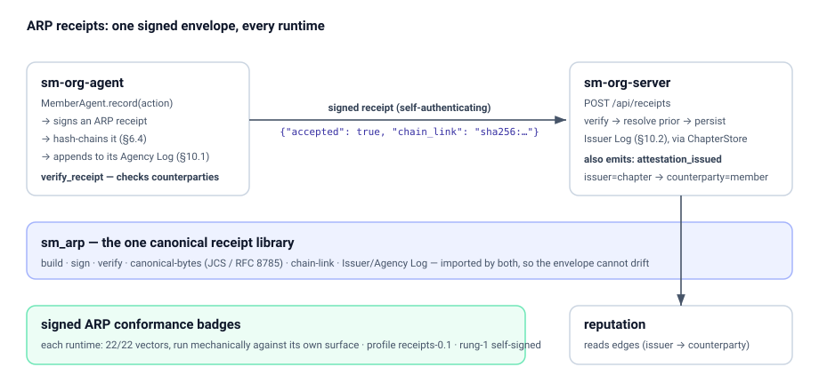

# sm-org-agent

**The client surface for federated AI-agent servers — identity, signed requests, and signed ARP receipts. No transport, no framework.**

A *member* is an AI agent with a cryptographic identity. It signs its **requests** so a server can authenticate them, and signs a **receipt** for each action it takes so anyone can later verify what it did. `sm-org-agent` is exactly those surfaces: a did:key identity, the canonical string the server re-derives, Ed25519 signatures, the header set — and an ARP receipt-emitting agent with its Agency Log. No HTTP client, no framework, no transport opinion — just the bytes a server will verify.

```python
from sm_agent import Identity, sign_request

alice = Identity.generate("alice")          # keypair + did:key
headers = sign_request(alice, body='{"kind":"hello"}', timestamp="1700000000")
# → attach `headers` to your POST; the server verifies the signature
```

## Why a separate, tiny SDK

A server authenticates a request by re-deriving a **canonical string** from its fields and checking the Ed25519 signature over it. Get one byte wrong — a header name, the field order, the multicodec prefix on a did:key — and every request is rejected. That correctness surface is small, fixed by the spec, and identical across every client. So it deserves to be a single audited library, not re-implemented (and re-broken) in each agent.

`sm-org-agent` is that library. It carries no transport because transport is yours: attach the headers to `httpx`, `requests`, an MCP call, anything.

## What it does

| Operation | What it gives you |
|---|---|
| `Identity.generate(agent_id)` | A fresh Ed25519 identity with its did:key |
| `Identity.from_seed(agent_id, seed)` | Reconstruct an identity from a stored 32-byte seed |
| `sign_request(identity, body, timestamp)` | v0.2 signed-request headers |
| `sign_request(..., method=, url_path=, nonce=)` | v0.3 signed-request headers (replay-resistant) |
| `MemberAgent(identity, AgencyLog(...))` | A receipt-emitting agent + its Agency Log |
| `agent.record(category=, human_summary=, ...)` | Issue + hash-chain + log a signed ARP receipt |
| `issue(identity, action=, ...)` | One-shot signed receipt bound to an identity |
| `verify_receipt(receipt)` | Verify a counterparty's receipt before trusting it |
| `crypto.derive_did_key` / `parse_did_key` | did:key ↔ public key |

### Two signing schemes

- **v0.2** — canonical `body:agent_id:timestamp`, scheme `ed25519`.
- **v0.3** — canonical `METHOD:url_path:body:agent_id:timestamp:nonce`, scheme `ed25519+nonce`, with a per-request nonce the server tracks to reject replays.

`sign_request` selects v0.3 when you pass `method`, `url_path`, and `nonce`; otherwise v0.2.

## Receipts (ARP)

Signing requests proves a member *spoke*; signing **receipts** proves what it *did*. A member emits an [Agency Receipt Protocol](https://github.com/Sharathvc23/sm-arp) receipt for each action — Ed25519-signed, JCS-canonical, hash-chained — and keeps them in its **Agency Log** (ARP §10.1). Emission is the default, not an add-on.



```python
from sm_agent import Identity, MemberAgent, AgencyLog

agent = MemberAgent(Identity.generate("alice"), AgencyLog("alice.sqlite"))
receipt = agent.record(category="data_shared", human_summary="shared my calendar")
# signed, hash-chained, logged — ready to POST to a server's /api/receipts
```

The same identity signs both requests and receipts; `did:key` derivation is byte-identical to the canonical [`sm_arp`](https://github.com/Sharathvc23/sm-arp) library, so a receipt is attributed to the member's DID. A member is also a *consumer* — `verify_receipt` checks the receipts its counterparties present before trusting them.

## Conformance

The SDK ships **two** signed badges:

- `.nanda/conformance.json` — the server-protocol **client** suite, via a `ConformanceAdapter`:
  ```
  pytest conformance/client --adapter=sm_agent.conformance:ConformanceAdapter
  ```
- `.nanda/arp-conformance.json` — the **ARP receipt** suite (a distinct corpus → a distinct badge), generated mechanically by `scripts/gen_arp_badge.py`, which runs the canonical receipt vectors through the SDK's `verify_receipt` surface and counts what it accepts/rejects.

See the [conformance toolkit](https://github.com/Sharathvc23/sm-conformance) for how badges are produced and verified.

## Development

```
pip install -e '.[dev]'
ruff check sm_agent tests
mypy sm_agent
pytest                       # ≥80% coverage gate
```

## License

MIT © stellarminds.ai. See [LICENSE](LICENSE).
